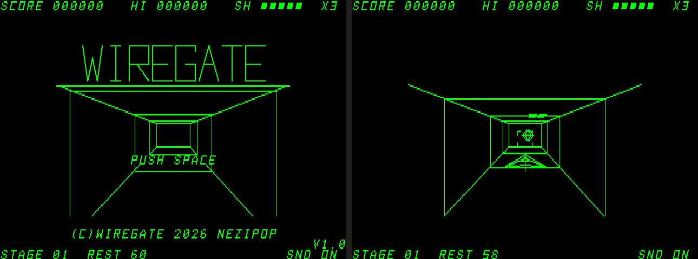

# WIREGATE

シャープ **MZ-2000 / MZ-2200** 用のワイヤーフレーム 3D シューティングです。
自機を後ろから見ながら、宇宙基地・谷・洞窟のゲートをくぐり抜け、砲台と敵を撃ち、3 体のボスを倒します。全 15 面。

- 版: V1.0
- (C)WIREGATE 2026 NEZIPOP

## ファイル

| ファイル | 中身 |
|---|---|
| `WIREGATE.d88` | ディスクのイメージ(このディスクから起動します) |
| `WIREGATE.mzt` | テープのイメージ |
| `WIREGATE_README.txt` | 遊び方の説明(この README と同じ内容のテキスト版) |
| `WIREGATE_screen.png` | 画面の写真 |

## 必要な機器

- シャープ MZ-2000 / MZ-2200 の実機、または EmuZ-2200 などの各種エミュレーター
- EmuZ-2200 と実機で、全面クリアまで確かめています。

## 動かし方

1. `WIREGATE.d88` をドライブに入れて起動します。
   - `WIREGATE.mzt` はテープのイメージです。テープから起動するときに使います(読みこみ方は、お使いのエミュレーターや機器の説明に従ってください)。
2. タイトルの曲が鳴ったあと、**SPACE** キーで始まります(曲は SPACE で飛ばせます)。

## 操作

| キー | 動き |
|---|---|
| 矢印キー、またはテンキーの 8・2・4・6 | 自機を上下左右に動かす |
| SPACE | ショット(押しっぱなしで連射。同時に 3 発まで) |
| P | ポーズ(もう一度 P で続き) |
| Z | 音を切る / 入れる |
| Y / N | 全面クリアのあとの `CONTINUE Y/N` に答える |

## 画面

- **上の行**: `SCORE` 点数 / `HI` 最高点 / `SH` シールド(■ が残り)/ `X` 残りの機数
- **下の行**: `STAGE` 面 / `REST` 残りのゲートの数 / `SND` 音の入・切
- 最高点は、電源を切ると消えます。

## 遊び方

- ゲートをくぐるたびに `REST` が減り、0 になると面クリアです(ボスの面は、ボスを倒すとクリア)。
- シールドは 5 つ。弾・敵・梁に当たると 1 つ、つららに当たると 3 つ減ります。当たった直後は、少しのあいだ当たりません。
- シールドが 0 になると 1 機失い、シールドは 5 に戻ります。3 機失うとゲームオーバーです。
- 面クリアのとき、残ったシールド 1 つにつき 100 点のボーナスが入り、シールドが 2 つ回復します。
- 敵の弾は 2 種類あります。
  - **ふつうの弾**: 点滅してから飛んできます。撃ち落とせます(50 点)。
  - **回る正方形の弾**: 撃ち落とせません。ショットも吸いこまれます。よけてください。

### 面の流れ

| 面 | 場所 | 中身 |
|---|---|---|
| 1〜6 | 宇宙基地 | 砲台、空中の敵、縦と横の梁 |
| 7 | 基地のボス | 壁の 4 つのサブコアを壊してから、まん中の核を撃つ |
| 8〜10 | 谷 | 壁の砲台、舞い降りてくる敵、床からのつらら |
| 11 | 谷のボス | 上にいるあいだは当たりません。下りてきた時に撃つ |
| 12〜14 | 洞窟 | 壁の砲台、後ろから来る敵 |
| 15 | 最後のボス | |

全面クリアすると `CONTINUE Y/N` と聞かれます。**Y** で点数と残りの機数を持ったまま面 1 からもう一度、**N** でタイトルへ戻ります。

### 点数

| 相手 | 点数 |
|---|---|
| 空中の敵 | 200〜300 点 |
| 砲台 | 150 点 |
| ふつうの弾 | 50 点 |
| 基地のボス | サブコア 300 点、核 5000 点 |
| 谷のボス・最後のボス | 当てるたびに 200 点、倒すと 5000 点 |

## おまけ(練習用)

| タイトルでの操作 | 始まる面 |
|---|---|
| 1 キーを押しながら SPACE | 面 8(谷) |
| 2 キーを押しながら SPACE | 面 12(洞窟) |

1・2 はキーボード上段の数字キーです。

## 制作

| 担当 | |
|---|---|
| 企画・ディレクション・デザイン・テスト・調整 | NEZIPOP |
| プログラム・作曲(効果音を含む) | Claude(Anthropic) |

- 自機・敵・ボスの形は、NEZIPOP の「XELA BLADE」のモデルから。
- 3 声の曲のプレイヤーは、NEZIPOP の「LIMIT OVER」から。
- 曲と効果音は、このゲームのためのオリジナルです。

## ライセンス

【作者が書き足す所】配布や転載の条件。
